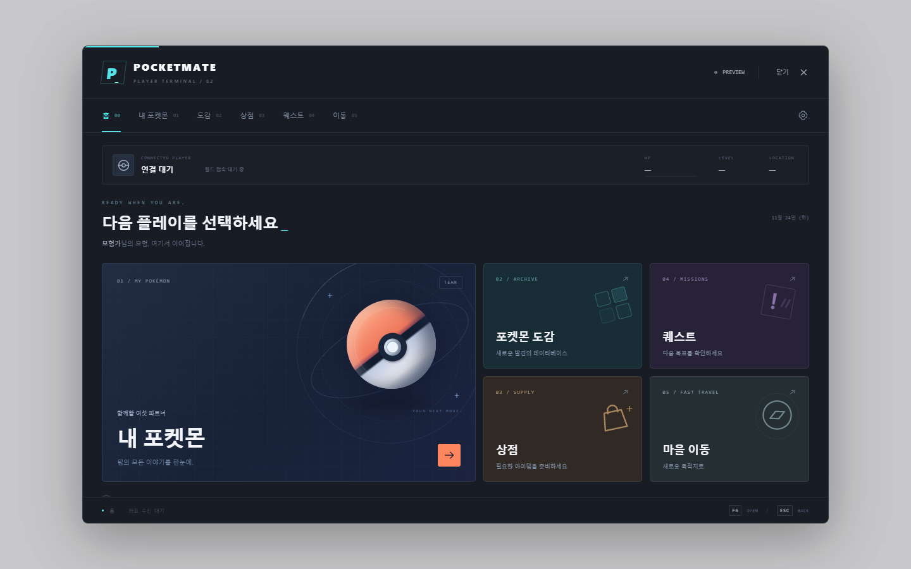

# 포켓메이트 · PokeMon Custom MC Server


친구들과 함께 사용할 Minecraft Java **1.21.1 / Fabric** 환경을 준비하는 프로젝트입니다. 포켓메이트 커스텀 런처, 인게임 WebGUI 메뉴, 영지·마을원·프로필 모드의 소스 및 작업 기록을 보관합니다.

이 저장소는 2026-11-24에 기존 로컬 작업을 처음 정리해 등록했습니다. 그 이전 개발 단계를 가짜 Git 커밋으로 재구성하지 않고, 아래 작업 과정과 원래 남아 있던 검증 자료로 구분해 기록했습니다. 문서 작성과 구현에는 Codex를 사용했습니다.

## 현재 구현 상태

| 구성 요소 | 현재 버전 | 역할 |
| --- | --- | --- |
| 포켓메이트 런처 | 0.3.1 | Prism 연결, 순정 1.21.1 실행, 서버 팩 검사·업데이트 |
| WebGUI 메뉴 | 0.13.2 | 일반 메뉴, 영지 관리소, 프로필 꾸미기, 공통 라이트·다크 모드 |
| 영지·프로필 Fabric 모드 | 0.8.0 | 서버 권한의 청크 소유권, 영지 금고·성장·마을원, 착용 프로필 공유 |
| 반투명 보완 클라이언트 모드 | 0.1.0 | WebGUI 2.0.0의 인게임 배경 알파 블렌딩 보완 |

최신 단계는 **Java 테스트 58개**, 클라이언트 요청 차원 검사 **80가지**, 프로필 표시·테마 저장 로직 검사와 구문 검사를 통과했습니다. 이 수치는 게임 플레이 성공률을 뜻하지 않습니다. 최신 영지 홈·이동 기능은 단위 검사와 브리지 계약 검사를 통과했으며, 실제 게임의 홈 지정·텔레포트와 최신 화면은 아직 검증하지 않았습니다. 모드 교체 상태는 [홈 기능 설치 보고서](docs/evidence/reports/webgui_menu/estate-home-install.json)를 확인하세요. 과거 인게임 검증과 최신 코드 검증은 [증거 자료 안내](docs/evidence/README.md)에서 따로 확인할 수 있습니다.

## 저장소 구조

```text
snowfrost_launcher/  C# / WPF 런처와 Prism·업데이트 연결
webgui_menu/        HTML·CSS·JavaScript 메뉴 및 SVG/PNG/폰트
estate_mod/         Fabric 서버·클라이언트 모드와 Java 테스트
docs/               상세 개발 과정, 구조, 운영·검증 기록
docs/evidence/      경로를 정리한 보고서, 과거 화면, JUnit 결과, SHA-256 목록
tools/              공개용 증거 정리 및 업로드 파일 검사
```

`snowfrost_launcher`는 처음 사용했던 내부 폴더명입니다. 사용자에게 표시되는 서비스 이름은 **포켓메이트 / POCKETMATE**로 통일했습니다. 빌드 결과 EXE·JAR·ZIP, 게임 월드와 계정 파일은 Git에 넣지 않습니다. 각 구성 요소의 빌드 명령은 아래에 안내합니다.

## 작업 과정

### 1. 커스텀 런처의 기본 구조

사용자가 제공한 화면처럼 전체 배경을 크게 두고, 왼쪽에 서버 이름·게임 시작 버튼, 오른쪽에 상태와 안내를 배치했습니다. 이후 포켓몬 서버 컨셉에 맞춰 포켓메이트라는 이름으로 정리했습니다.

처음에는 Microsoft 직접 인증과 게임 설치 코드를 검토·구현했지만, 최종 실행 경로는 **이미 설치된 Prism Launcher**를 이용하도록 변경했습니다. 계정 로그인, 게임 이용 권한, Java와 게임 파일 설치는 Prism이 처리하고 포켓메이트는 선택한 인스턴스 실행을 요청합니다. 레거시 인증 코드는 소스에 남아 있으나 현재 게임 시작 버튼의 실행 경로는 `PrismBridge.cs`입니다.

서버 업데이트 주소가 없으면 **순정 Minecraft 1.21.1**을 실행합니다. 주소가 있으면 manifest의 파일 경로·크기·SHA-256을 검사하고 변경·누락·손상 항목이 있을 때 버튼을 업데이트로 바꿉니다. 다운로드와 검증을 마친 다음 게임을 실행합니다. 서버용 인스턴스는 기본 순정 인스턴스와 분리하며, 적용 실패 시 변경을 되돌리고 기존에 관리하던 파일만 정리합니다. 서버 팩 기본 로더는 Fabric입니다. 실행 횟수 표시는 제거했습니다.

관련 자료: [런처 사용·빌드 안내](snowfrost_launcher/README.md), [46개 백엔드 검사 기록](docs/evidence/reports/snowfrost_launcher/backend-report.json), [최종 상태](docs/evidence/reports/snowfrost_launcher/final-report.json).

### 2. 인게임 메뉴와 테마 재설계

WebGUI를 싱글플레이 테스트 인스턴스에 연결하고 기본 메뉴를 구성했습니다. 초기 디자인을 바꿔 인게임 화면이 주변으로 비치는 반투명 외곽, 왼쪽 탭, 상단 프로필카드, 기능 타일 구조로 재설계했습니다.

글자 크기 `+ / −`는 일반 글자와 탭 글자에 적용하며 범위는 80~160%입니다. 일반 버튼의 글자 크기는 따로 유지합니다. 하단 좌표와 키 안내의 대비, 배경색의 이음새도 정리했습니다. 이후 일반 메뉴와 별도 전체화면 영지 관리소가 하나의 테마를 쓰도록 통일하고, 설정에서 전환·저장되는 라이트·다크 모드를 추가했습니다. NanumSquareRound 폰트와 직접 제작한 24종 SVG 아이콘을 적용했습니다.

대표 이미지는 사용자 피드백에 따라 간략화하고, 위쪽 별과 아래쪽 보석을 유지했습니다. 밝은 배경과 어두운 배경에 함께 사용할 수 있는 색상으로 조정한 뒤, 주변 글자·버튼 배치를 움직이지 않고 헤더 로고의 시각적 크기를 키웠습니다. 제목 끝의 장식 `_`를 `.`로 바꾸고 문구·띄어쓰기를 정리했으며, 실제 닉네임의 밑줄은 보존합니다.

아래는 **이전 디자인 검증 화면**입니다. 최신 로고·테마·프로필 공유 적용 결과를 보여 주는 이미지가 아닙니다.



### 3. 영지 생성과 청크 구매

메뉴의 영지 기능을 작은 패널에서 분리해 전체화면 영지 관리소로 만들었습니다. 처음 생성할 때 이름을 입력하며, **현재 서 있는 소유주 없는 오버월드 청크**를 기본 영지로 등록합니다.

지도에서 청크를 클릭하면 선택·취소할 수 있고 여러 청크를 한 번에 구매할 수 있습니다. 이미 점유된 청크는 선택하지 못합니다. 선택한 묶음 전체가 기존 내 영지와 한 면 이상 이어져야 하며 대각선 연결은 인정하지 않습니다. 클라이언트 안내와 별도로 서버가 권한·중복·인접성·경계·가격·잔액·레벨 한도를 검사하고, 전체 구매를 하나로 저장합니다. 저장에 실패하면 소유권과 결제를 함께 취소합니다.

지도는 별도 지형을 임의 생성하지 않고 **Xaero가 이미 기록한 오버월드 지형**을 읽습니다. 기본 지도 배율은 청크당 32px, 축척 표시는 최대 128블록 단위입니다. 소유권 표시는 서버 자료를 사용하므로 Xaero 지형을 불러오지 못해도 소유권 조회를 분리해 처리합니다.

영지 생성과 영토 구매는 서버의 실제 플레이어 차원을 확인해 **오버월드에서만 허용**합니다. 네더·엔드·다른 차원으로 이동하면 메뉴의 구매 확인창을 닫고 선택을 비웁니다. 소유권 파일의 차원도 `minecraft:overworld`로 고정했습니다. 이 모드는 네더·엔드 청크 파일을 생성·수정·삭제하지 않으며, 두 차원의 주기 초기화 기능 자체는 아직 구현하지 않았습니다.

관련 자료: [초기 인게임 영지 검증](docs/evidence/reports/webgui_menu/estate-integration-report.json), [차원 제한 검사](docs/evidence/reports/webgui_menu/overworld-policy-report.json).

### 4. 광장·마을원·영지 관리

광장에는 영주가 고르는 대표 이미지, 영주만 수정할 수 있는 공지, 닉네임·등급·접속 상태·마지막 접속 시각이 있는 마을원 표를 추가했습니다. 영주·부영주·영지민으로 등급을 나누고, 영주에게 초대·추방·등급 조정 권한을 부여했습니다. 초대창은 접속 유저와 이름 검색을 제공하며 상대가 수락해야 가입됩니다.

지도 설정은 왼쪽 아래로 내리고 그 위에 영지 삭제를 배치했습니다. 삭제할 때는 확인창에 **영지 이름을 정확히 입력**해야 합니다. 서버가 삭제 권한과 이름을 다시 확인하며, 삭제되는 영지의 청크·금고·성장 자료와 개인 프로필·개인 지갑을 구분합니다.

### 5. 영지 금고와 성장 규칙

생성 직후는 레벨 0, 기본 1청크입니다. 레벨 1 승급은 무료이고 4청크까지 확장할 수 있습니다. 최대 레벨은 10, 청크 한도는 36입니다. 최대 인원은 향후 레벨별 조정을 위해 별도 규칙으로 두되 **현재 모든 레벨에서 영주 포함 5명**으로 고정했습니다.

| 진입 레벨 | 해당 레벨 승급 비용 | 최대 청크 | 최대 인원 |
| --- | ---: | ---: | ---: |
| 0 | 생성 시 무료 | 1 | 5 |
| 1 | 0원 | 4 | 5 |
| 2 | 50,000원 | 6 | 5 |
| 3 | 100,000원 | 9 | 5 |
| 4 | 200,000원 | 12 | 5 |
| 5 | 350,000원 | 16 | 5 |
| 6 | 550,000원 | 20 | 5 |
| 7 | 800,000원 | 24 | 5 |
| 8 | 1,100,000원 | 28 | 5 |
| 9 | 1,500,000원 | 32 | 5 |
| 10 | 2,000,000원 | 36 | 5 |

기본 4청크까지 무료이며, 5번째부터 20,000원으로 시작해 구매할 때마다 2,500원씩 증가합니다. 여러 청크를 구매하면 각 순번의 가격을 합산합니다. **청크 구매는 금고 우선 → 부족분을 영주 개인 지갑에서 보충 → 합산 잔액도 부족하면 전체 취소** 순서입니다. 승급 비용은 금고에서만 차감합니다. 금고·성장 화면에는 현재 상태, 성장 단계 전체 표, 최대 인원과 거래 기록을 표시합니다.

현재 지갑은 이 모드의 테스트용 재화입니다. 실제 서버 경제 모드와는 아직 연결하지 않았습니다. 규칙의 원본은 [EstateRules.java](estate_mod/src/main/java/space/pocketmate/estates/EstateRules.java)입니다.

### 6. 개인 프로필과 유저 표시 통일

프로필카드는 플레이어 이름, 칭호, 아이콘, 배너, HP·레벨·위치를 표시합니다. 프로필 편집에서 보유 항목을 미리보기하고 저장하며, 서버는 보유하지 않은 아이템의 착용을 거부합니다. 칭호 앞 SVG는 보유 목록에도 표시하며 글자 크기와 색상을 따라갑니다. 불필요한 게임 모드 설명은 제거했습니다.

**프로필아이콘 기본값은 본인 스킨 얼굴**입니다. 이미 선택한 포켓몬 아이콘이나 배너를 덮어쓰지 않습니다. 얼굴은 모자 레이어를 포함하며, 다른 유저의 얼굴은 UUID별로 구분합니다. 오프라인 유저는 Minecraft 스킨 조회·캐시를 사용하고 조회 중에는 이름 첫 글자를 표시합니다.

0.7.0에서는 광장과 마을원 관리 표, 초대 검색·대기, 등급 변경·추방 확인창, 지도 위 내 위치에 실제 착용한 아이콘·배너를 연결했습니다. 공개 조회는 착용 정보만 전달하며 보유 목록·재화는 보내거나 새 프로필을 저장하지 않습니다. 프로필카드의 배너·덮개를 같은 배경 영역에서 그려 경계 차이를 줄이고, 별도 그림자와 표 첫 셀의 배치 방식을 정리했습니다.

관련 자료: [과거 프로필 인게임 검증](docs/evidence/reports/webgui_menu/profile-integration-report.json), [최신 프로필 공유 코드 검증](docs/evidence/reports/webgui_menu/public-profiles-update-report.json), [모드 파일 교체 상태](docs/evidence/reports/webgui_menu/public-profiles-install.json).

## 빌드와 검사

Windows 기준입니다. 외부 Minecraft·Fabric·WebGUI·Xaero·Prism 프로그램과 게임 계정은 저장소에 포함하지 않습니다.

```powershell
# 런처 (.NET Framework 4.8 / WPF, Windows 내장 C# 컴파일러)
cd snowfrost_launcher
.\build.ps1
python verify_backend.py

# 영지·프로필 모드 (Java 21, Gradle 8.12.1)
cd ..\estate_mod
python build.py

# 게임/브라우저를 열지 않는 메뉴 로직 검사
cd ..
node webgui_menu/verification/check_appearance.cjs
node webgui_menu/verification/check_estate_dimension.cjs
node webgui_menu/verification/check_people.cjs
node webgui_menu/verification/check_estate_home.cjs
node webgui_menu/verification/check_travel.cjs

# 공개용 증거 갱신과 업로드 대상 검사
python tools/prepare_evidence.py
python tools/check_publish.py
```

`estate_mod/build.py`는 OneDrive 잠금을 피하려고 `%LOCALAPPDATA%/PocketmateEstateBuild`에 빌드를 준비합니다. Java·Gradle 위치는 해당 스크립트에 지정돼 있으므로 다른 PC에서는 환경에 맞게 조정해야 합니다. 브라우저 검증 스크립트는 과거 UI 검증을 재현할 때 사용하며 별도 Playwright와 Edge 설정이 필요합니다. 최신 작업에서는 사용자 요청에 따라 게임 조작·화면 검증을 진행하지 않았습니다.

## 적용과 보존

- **HTML·CSS·JavaScript만 변경:** 게임 채팅 `/webgui reload` 후 F6으로 다시 열기.
- **JAR 변경:** 게임과 서버를 완전히 종료하고 새 JAR 하나만 설치한 뒤 재시작. 0.8.0은 서버와 플레이어 클라이언트 양쪽에 필요합니다.
- 영지: 월드 루트 `data/pocketmate-estates.json`, 현재 format 4. 구형 format 1~3 이관은 기존 소유권을 보존하며 최초 소유 청크에 기본 홈을 부여합니다. 이관 후 구형 JAR로 되돌리지 마세요.
- 프로필: 월드 루트 `data/pocketmate-profiles.json`, format 1. 프로필과 영지 저장을 분리합니다.
- 저장 실패·손상 시 기존 소유권이나 꾸미기를 자동으로 빈 자료로 초기화하지 않습니다.
- 개인 월드·토큰·Prism 계정·실제 재화 저장 파일은 Git에 올리지 않습니다.

## 아직 연결하지 않은 부분

실제 운영 서버, 외부 경제 모드, 경매장·유저 간 거래, 포켓몬 파티·도감 데이터, 보상 기반 꾸미기 해금, Shift+F 연결과 네더·엔드 주기 초기화는 후속 작업입니다. **현재 청크 소유권 등록과 별개로 블록 설치·파괴 보호는 아직 구현하지 않았습니다.** 최신 홈 지정·이동과 다중 접속·화면 정렬의 실제 게임 결과도 추가 확인이 필요합니다.

## 작업 기록과 매시간 백업

[상세 개발 이력](docs/DEVELOPMENT_HISTORY.md), [구조와 데이터 흐름](docs/ARCHITECTURE.md), [검증 자료 목록](docs/evidence/README.md), [자동 기록·푸시 운영 방식](docs/AUTOMATION.md)을 함께 관리합니다.

매시간 변경 사항을 확인하고, 작업이 있으면 관련 README·기록·증거를 갱신한 뒤 검사·커밋·일반 푸시를 수행합니다. 변경이 없으면 빈 커밋을 만들지 않습니다. 로컬 Codex 자동화이므로 PC 절전·앱 종료·네트워크 또는 인증 문제로 실행이 지연될 수 있습니다. 원격 이력을 덮어쓰는 강제 푸시는 사용하지 않습니다.

타사 에셋·폰트에 관한 표기는 [THIRD_PARTY_NOTICES.md](THIRD_PARTY_NOTICES.md)를 참고하세요.

### 최근 화면 정리 · 메뉴 0.12.1

영토 구매 패널의 선택 방법과 구매 조건·가격 설명을 각각 제목 옆과 구매 총액 옆의 `?` 도움말로 옮겼습니다. 마우스 올리기·키보드 포커스·클릭으로 설명을 확인하고 Esc로 닫을 수 있습니다. 도움말은 패널 스크롤 영역 밖에 표시해 잘리지 않도록 화면 안에 배치합니다. 다른 차원에서 구매가 제한되는 상태 안내는 그대로 표시합니다. `/webgui reload` 후 F6으로 적용하며 재시작은 필요하지 않습니다. 코드·CSS 검사만 수행했고 실제 게임 화면은 확인하지 않았습니다.

### 홈 화면 스크롤 정리 · 메뉴 0.12.2

홈의 고정 픽셀 높이 타일을 남은 공간에 맞춰 배치하고 홈 콘텐츠의 스크롤을 막았습니다. 다른 탭은 기존 스크롤을 유지하며 좁은 화면은 2열, 높이가 낮은 화면은 장식·보조 문구를 줄여 기능 버튼을 유지합니다. 코드·CSS 검사만 수행했고 게임 화면은 확인하지 않았습니다. `/webgui reload` 후 F6으로 적용하며 재시작은 필요하지 않습니다.

### 프로필 저장 버튼 고정 · 메뉴 0.12.3

프로필 편집의 미리보기·보유 항목을 내부 스크롤 영역으로 분리하고 저장·선택 되돌리기·피드백 행은 하단에 고정했습니다. 라이트·다크 테마와 작은 화면의 버튼 줄바꿈을 유지합니다. 코드·CSS 검사를 수행했으며 게임/브라우저 화면 검증은 하지 않았습니다. `/webgui reload` 후 F6으로 적용하고 재시작은 필요하지 않습니다.

### 프로필 고정 범위 수정 · 메뉴 0.12.4

프로필 편집은 제목·설명·미리보기·보유 목록·저장 피드백을 포함해 페이지 전체가 스크롤됩니다. 선택 되돌리기·프로필 저장 두 버튼만 하단에 붙도록 고정 범위를 수정했습니다. 이전 내부 스크롤을 없애고 하단 버튼 행만 sticky로 배치합니다. 구문·CSS 검사만 수행했으며 실제 화면은 미검증입니다. `/webgui reload` 후 F6으로 적용하며 재시작은 필요하지 않습니다.

### 변경사항이 있을 때만 저장 영역 표시 · 메뉴 0.12.5

프로필 저장·되돌리기 버튼은 변경사항이 있을 때만 둥근 테두리의 하단 영역에 표시합니다. 저장 성공 또는 되돌리기로 착용 상태와 같아지면 영역이 사라지며, 저장 중에는 버튼을 잠급니다. 제목부터 목록·피드백까지 하나의 영역에서 스크롤되고, 버튼은 별도 행을 차지해 목록을 덮지 않습니다. 구문·CSS 검사와 실제 미리보기 로직의 변경/저장 중 상태를 브라우저 없이 확인했습니다. `/webgui reload` 후 F6으로 적용하며 재시작은 필요하지 않습니다.

### 저장 영역 전환·크기·색상 조정 · 메뉴 0.12.6

변경사항에 따라 표시되는 저장 영역이 약 0.28초 동안 아래에서 위로 올라오며 나타나고, 사라질 때도 부드럽게 접힙니다. 목록 공간도 함께 전환해 갑작스러운 크기 변화를 줄이고, 탭 전환·저장 요청으로 다시 렌더링해도 애니메이션 영역을 유지합니다. 배경 박스를 두 버튼에 맞는 크기와 6px 안쪽 여백으로 줄이고 다크 모드는 짙은 청록색·밝은 테두리, 라이트 모드는 연한 녹색·짙은 테두리를 적용했습니다. 움직임 줄이기 설정을 존중합니다. 상태 로직·구문·CSS 검사만 수행했으며 실제 게임 애니메이션은 미검증입니다. `/webgui reload` 후 F6으로 적용합니다.

### 저장 버튼 뒤의 가로 가림 제거 · 메뉴 0.12.7

저장 영역을 위해 전체 너비로 공간을 떼어 놓던 구조를 없애고, 투명한 위치 영역에 작은 둥근 버튼 박스만 오른쪽 아래에 띄웁니다. 목록은 바닥까지 보이며 마지막 항목은 추가 스크롤 여유로 버튼 위까지 올릴 수 있습니다. 변경사항이 생기는 순간 Web Animations API로 아래→위 300ms 등장 효과를 직접 실행하고, 재렌더링·저장 중에는 반복하지 않습니다. 닫는 중 다시 수정하면 이전 효과를 취소하고 새로 표시하며 움직임 줄이기 설정은 유지합니다. 코드·상태 로직·CSS 검사만 수행했으며 실제 게임 화면은 미검증입니다. `/webgui reload` 후 F6으로 적용합니다.

### 영지 설정과 마을 이동 · 메뉴 0.13.0 / 모드 0.8.0

영지의 기록 탭을 제거하고 **영지 설정** 탭을 추가했습니다. 홈 지정 등 운영 설정을 모을 수 있는 별도 페이지이며 현재는 영지 홈 카드와 이동 버튼을 제공합니다. 마을 이동 버튼(홈 타일·영지 설정)은 소속 영지의 저장된 홈으로 바로 이동합니다. 소속 영지가 없으면 안내합니다.

새 영지는 영지를 생성한 순간의 정확한 오버월드 위치·시선 방향을 기본 홈으로 함께 저장합니다. **영주만 현재 위치를 홈으로 지정**할 수 있으며, 오버월드의 자기 소유 청크 안에서 안전하고 단단한 바닥에 서 있어야 합니다. 좌표를 브라우저에서 지정해 보내지 않고 서버가 실제 플레이어 위치와 권한을 확인합니다. 부영주·영지민은 홈을 바꾸지 못하지만 마을 이동을 사용할 수 있습니다.

이전 영지 자료는 최초 생성 당시의 정확한 Y좌표·시선을 갖고 있지 않습니다. 소유권·금고·마을원·꾸미기는 유지하고 가장 오래된 소유 청크를 기본 홈 청크로 이관합니다. 이동 시 그 청크 안의 안전한 지표면을 찾으며 영주가 직접 홈을 지정하면 정확한 위치로 고정됩니다. 막힌 공간·위험 블록·액체·월드 경계 밖이면 이동하지 않으며, 자동 지표 탐색도 오버월드의 해당 청크만 사용합니다. 이동은 무료이며 연속 사용은 5초 간격으로 제한합니다.

서버 저장 형식은 format 4입니다. Java 58개(신규 홈 저장·권한·이관·실패·손상 검사 8개 포함), 홈 설정 표시 계약과 이동 요청·응답 검사, 기존 차원 요청 검사 80가지를 통과했습니다. 실제 게임 이동은 실행하지 않았습니다. **이번에는 JAR가 바뀌므로 게임/서버를 완전히 종료하고 0.8.0으로 교체한 뒤 다시 실행해야 합니다.** 테스트 인스턴스는 파일 잠금이 풀리면 자동 교체하도록 준비하며 기존 월드 데이터는 직접 수정하지 않습니다.

### 메인 탐색 정리 · 메뉴 0.13.1

왼쪽의 내 포켓몬·도감·이동 탭을 제거해 홈·상점·퀘스트·영지관리·설정만 표시합니다. 홈의 큰 내 포켓몬 타일은 나침반 그림의 워프 타일로 교체했으며, 아직 등록된 공용 워프가 없어 준비 안내를 표시합니다. 기존 작은 마을 이동 타일은 영지 홈 이동을 유지합니다. 포켓몬 도감 자리는 텍스트·그림·클릭 동작이 없는 빈 타일로 남겼습니다. HTML 탐색·빈 타일 속성, JavaScript 구문·CSS 파싱을 확인했고 실제 화면은 검증하지 않았습니다. `/webgui reload` 후 F6으로 적용하며 이번 변경으로 추가 재시작은 필요하지 않습니다.

### 워프 전용 아이콘 · 메뉴 0.13.2

워프의 나침반을 직접 그린 포털 SVG로 교체했습니다. 기울어진 이중 링·금빛 중심·이동 궤적을 큰 홈 타일과 워프 안내 화면에 사용하며 라이트·다크 테마 색을 지원합니다. 버튼 배치와 이동 기능은 유지합니다. SVG XML·아이콘 등록·JavaScript 구문·CSS 파싱을 검사했으며 게임·브라우저 화면 검증은 하지 않았습니다. 화면 파일 변경으로 `/webgui reload` 후 F6으로 적용하며 이번 변경에 재시작은 필요하지 않습니다.
