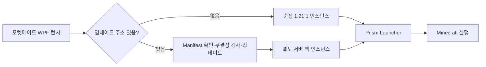
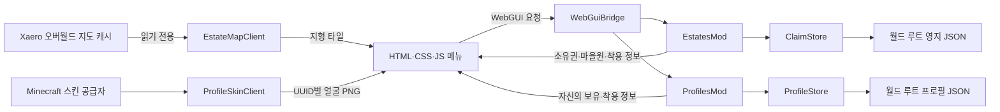

# 구조와 데이터 흐름

## 런처 → Prism → 게임

런처는 Prism의 계정 파일·토큰을 읽지 않는다. 사용자 설정은 로컬 사용자 영역에 저장한다. 서버 팩 업데이트는 명시된 관리 경로에만 적용하며 기본 순정 인스턴스를 서버 모드 설치 대상으로 삼지 않는다.

## WebGUI ↔ Fabric

화면의 선택·가격 표시는 안내다. 생성·구매·승급·초대·추방·착용의 최종 권한과 저장은 서버가 검사한다. 플레이어 UUID는 서버 플레이어 객체에서 얻고 클라이언트가 보낸 소유주 값을 신뢰하지 않는다.

### 영지

- `EstatesMod`: 요청 형식, 중복 요청, 요청 간격, 실제 차원과 월드 경계, 스냅샷·커뮤니티 전송.
- `ClaimStore`: 청크 소유권·연결성, 묶음 구매, 회원 권한, 금고·지갑·성장과 원자적 저장.
- `EstateRules`: 레벨 한도·비용·정원·누적 청크 가격.
- `EstateMapClient`: Xaero가 이미 렌더링한 지형을 읽는다. Minecraft 청크를 강제로 생성하거나 다른 차원을 수정하지 않는다.
- `estate-map.js`: 지도 타일·소유권·선택 렌더링과 이동·확대·축척.

영지 저장은 format 4이며 `dimension`은 `minecraft:overworld`다. 네더·엔드 초기화 대상 디렉터리에 영지 데이터를 쓰지 않는다. 생성·구매의 서버 차원 검사는 0.6.1부터 존재했고 0.11.3 메뉴에서 화면 차단과 이동 시 정리를 보완했다.

### 프로필

- `ProfilesMod` / `ProfileStore`: 보유 항목과 착용을 서버에서 저장·검사한다. 기본값은 스킨 얼굴이다.
- 자신의 편집 화면에는 자신의 보유 목록을 보내지만, 마을원·초대의 공개 표시에는 착용 아이콘·배너만 보낸다.
- 공개 조회는 새로운 사용자 자료를 저장하지 않는다. 오프라인 마을원의 기존 착용도 같은 UUID로 조회한다.
- `ProfileSkinClient`: 접속 유저의 로드된 스킨을 우선 사용하고, 오프라인 프로필은 비동기 조회·캐시한다. 동시에 2건, 얼굴 추출은 틱당 2개로 제한한다.
- `people.js` / `people.css`: 사용자별 배너·아이콘·이름을 일관되게 표시한다. 얼굴 이미지와 다른 유저의 UUID가 섞이지 않도록 구분한다.
- `appearance.js`: 문서 최상위의 테마를 먼저 적용하고 저장한다. 두 메뉴에 같은 선택이 적용된다.

## 원자적 저장과 이관

수정한 전체 상태를 임시 파일에 기록하고 교체한 뒤 메모리에 반영한다. 실패하면 새 소유권·재화가 부분 반영되지 않도록 한다. 기존 파일의 형식이 잘못됐을 때 빈 파일로 초기화하지 않는다. 영지 format 1/2 이관은 청크 수를 보존하면서 수용 가능한 최소 레벨을 부여한다. format 1~3 이관은 최초 소유 청크에 기본 홈을 부여하며, format 4부터 홈의 위치·시선·지표 탐색 여부를 영지 자료와 함께 원자적으로 저장한다.

현재 JSON 저장은 테스트 서버 규모를 위한 구현이다. 경매장·거래소용 별도 DB나 외부 경제 시스템은 아직 연결하지 않았다. 향후 결제를 연결할 때는 현재 테스트 지갑과 실제 지갑을 중복 원장으로 운영하지 않도록 통합해야 한다.

## 영지 홈과 이동 (0.8.0)

`ClaimStore.Home`은 x/y/z·yaw/pitch·surface를 저장한다. 새 생성은 서버 플레이어의 실제 위치를 저장하고, 이전 자료는 가장 오래된 소유 청크 안의 지표 탐색 홈으로 이관한다. 홈은 영지 설정 변경·회원 변경·경제 거래에도 보존되며 영지 삭제 시 함께 제거한다.

`setHome`은 서버가 영주·오버월드·소유 청크·안전한 바닥을 검사한다. 사용자 좌표는 사용하지 않는다. `teleportHome`은 소속 영지 조회 후 오버월드 목적지만 로드하고, 충돌·바닥·액체·주요 위험 블록·경계를 검사한 뒤 이동한다. 원점 차원의 블록이나 청크를 수정하지 않는다. 생성·구매의 오버월드 제한도 유지한다.

`travel.js`는 목적지나 사용자 UUID를 받지 않고 이동 요청만 전송한다. requestId가 맞는 응답만 처리하고 중복 요청·타임아웃을 처리한다. 성공 시 메뉴를 닫고 실패 시 안내하며 자동 재전송하지 않는다. `estate-app.js`의 영지 설정 카드가 홈 조회와 영주 전용 설정을 제공한다.
